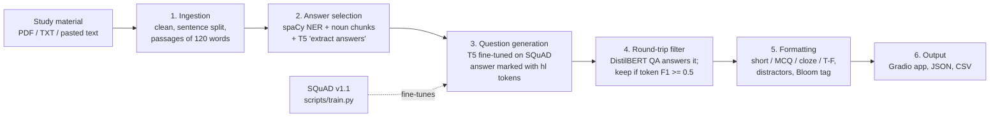
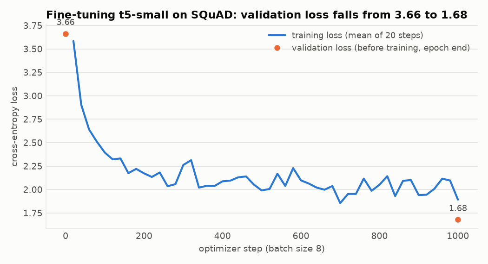
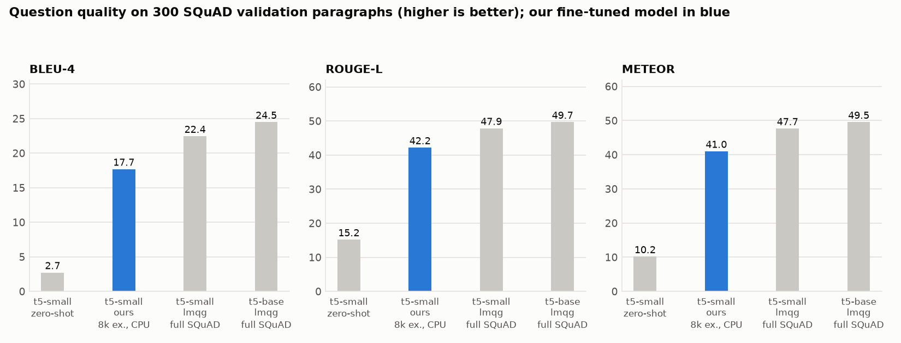

# StudyQG: Automatic Question Generation from Study Material

**CSPE72 Deep Learning Techniques, Assignment Team 3**
Asil Khalifa (106123015), L Hitesh Reddy (106123073), P Kamal Nag (106123093)

StudyQG turns study material (a PDF, a text file or pasted notes) into exam-style questions:
short answer, multiple choice with distractors, fill in the blank, and true/false. A T5
sequence-to-sequence Transformer fine-tuned on SQuAD writes the questions; a DistilBERT
question-answering model checks every question before it is shown.

## Architecture



| Stage | Module | What it does |
| --- | --- | --- |
| 1 | `studyqg/ingest.py` | PDF text via PyMuPDF, ligature/hyphenation fixes, junk-line removal, spaCy sentence split, passages of at most 120 words |
| 2 | `studyqg/answer_extraction.py` | Named entities and noun chunks scored by type, role and document frequency; T5 "extract answers:" mode; round-robin selection across passages for coverage |
| 3 | `studyqg/question_generator.py` | Wraps the answer in `<hl>` tokens, prepends "generate question:", beam search (4 beams) |
| 4 | `studyqg/quality_filter.py` | DistilBERT-SQuAD answers the generated question; SQuAD token-F1 against the intended answer is the quality score |
| 5 | `studyqg/distractors.py`, `studyqg/pipeline.py` | MCQ distractors (same-type spans, WordNet siblings, perturbed numbers), cloze and true/false items, Bloom level tag, de-duplication |
| 6 | `app/app.py`, `scripts/generate.py` | Gradio web demo and command-line interface, JSON/CSV export |

## Setup

```bash
git clone https://github.com/asil-khalifa/dl-project.git
cd dl-project
python3 -m venv .venv && source .venv/bin/activate      # Windows: .venv\Scripts\activate
pip install torch --index-url https://download.pytorch.org/whl/cpu   # or the CUDA wheel
pip install -r requirements.txt
python scripts/setup_resources.py                        # spaCy model + NLTK data
```

Python 3.10+ is required. Models (about 1.3 GB in total) download from the Hugging Face hub on first use.

## Run the demo

```bash
python app/app.py            # open http://localhost:7860
```

Upload a PDF or paste text, choose the number of questions and the types, click **Generate questions**.
The table shows every question with its answer, options, round-trip quality score, Bloom level and
source sentence. JSON and CSV downloads are provided. Three sample texts live in `data/sample/`.

Command line:

```bash
python scripts/generate.py --input data/sample/isro.txt --n 10 --types short,mcq,fill,tf
python scripts/generate.py --input lecture.pdf --n 15 --model models/t5-small-studyqg
```

## Train and evaluate

```bash
bash scripts/run_experiments.sh          # data -> fine-tune t5-small -> evaluate 4 models -> plots
```

or step by step:

```bash
python scripts/prepare_data.py --train_size 8000 --val_size 300   # SQuAD -> data/squad_hl/*.jsonl
python scripts/train.py --epochs 1 --batch_size 8 --lr 3e-4       # -> models/t5-small-studyqg, results/train_log.json
python scripts/evaluate.py --model models/t5-small-studyqg --name t5-small-ours --limit 300
python scripts/evaluate.py --model lmqg/t5-base-squad-qg-ae --name t5-base-lmqg --limit 300
python scripts/plot_results.py                                     # -> results/training_curve.png, results/metrics.png
python -m pytest tests                                             # unit tests, no model download
```

Training data format (`scripts/prepare_data.py`):

```
source: generate question: ... starring as blues singer <hl> Etta James <hl> in the 2008 musical biopic ...
target: Who did Beyonce play in Cadillac Records?
```

## Results

Evaluation on 300 SQuAD v1.1 validation paragraphs (one question each, beam size 4,
`scripts/evaluate.py`). Scores are 0-100, higher is better. Timings are per question on a
16-core laptop CPU (8 PyTorch threads, no GPU).

| Model | Training data | BLEU-4 | ROUGE-L | METEOR | s / question |
| --- | --- | --- | --- | --- | --- |
| t5-small, zero-shot (no fine-tuning) | none | 2.7 | 15.2 | 10.2 | 0.55 |
| **t5-small, ours** (`scripts/train.py`) | 8,000 SQuAD examples, 1 epoch, 49 min on CPU | **17.7** | **42.2** | **41.0** | 0.63 |
| t5-small, lmqg | full SQuAD (87.6k), GPU | 22.5 | 47.9 | 47.7 | 0.91 |
| t5-base, lmqg (demo default) | full SQuAD (87.6k), GPU | 24.5 | 49.7 | 49.5 | 2.69 |

Fine-tuning on 9% of SQuAD for one epoch on a laptop CPU takes the validation loss from 3.66 to
1.68 and closes about 80% of the gap between the zero-shot model and the full-data checkpoint of
the same size. The rest of the gap is data (11x more) and model size (t5-base is 3.7x larger and
3x slower).





Round-trip filter on the sample texts (t5-base): 18 of 18 generated questions were answerable by
DistilBERT with token F1 >= 0.5 on the neural-networks sample, 11 of 15 on the ISRO sample with
t5-small. Demo screenshots are in `results/screenshots/`, example outputs in `results/sample_output_*`.

## Repository layout

```
studyqg/            Python package (pipeline stages)
scripts/            data preparation, training, evaluation, plotting, CLI
app/app.py          Gradio demo
data/sample/        sample study material
results/            metrics.csv, eval_*.json, plots, screenshots
tests/              unit tests
```

## References

- Raffel et al. (2020). Exploring the limits of transfer learning with a unified text-to-text transformer (T5). JMLR.
- Rajpurkar et al. (2016). SQuAD: 100,000+ questions for machine comprehension of text. EMNLP.
- Ushio, Alva-Manchego and Camacho-Collados (2022). Generative language models for paragraph-level question generation (lmqg). EMNLP.
- Alberti et al. (2019). Synthetic QA corpora generation with roundtrip consistency. ACL.
- Du, Shao and Cardie (2017). Learning to ask: neural question generation for reading comprehension. ACL.
- Heilman and Smith (2010). Good question! Statistical ranking for question generation. NAACL.
- Sanh et al. (2019). DistilBERT, a distilled version of BERT.

## AI tool usage

Claude Code (Anthropic, Claude Fable 5.1) was used to scaffold the repository, draft the code, the
README and the report under the team's direction. The team reviewed, ran and debugged everything;
all reported numbers come from the scripts in this repository.

## License

MIT
